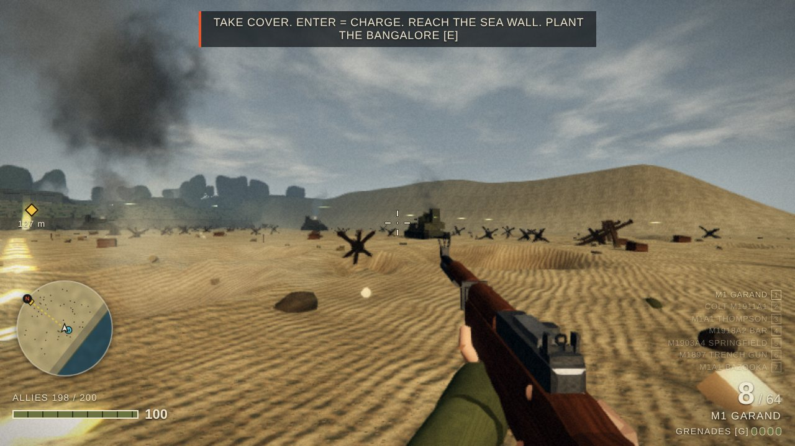
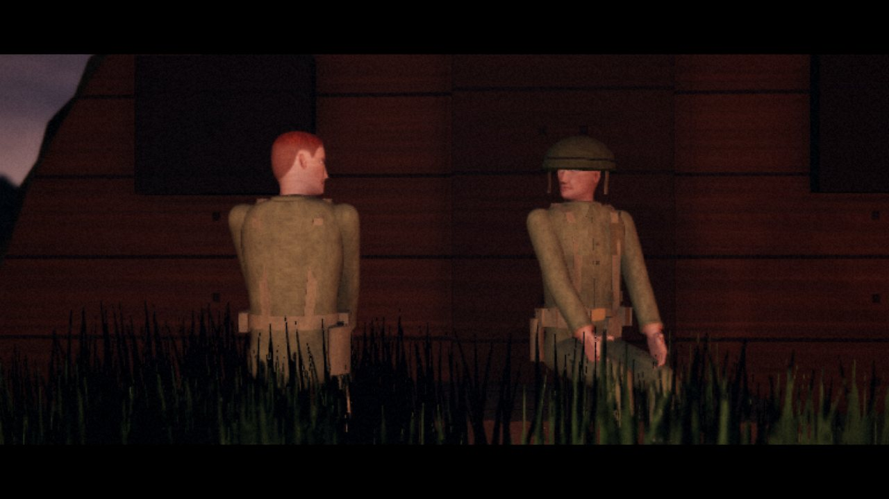
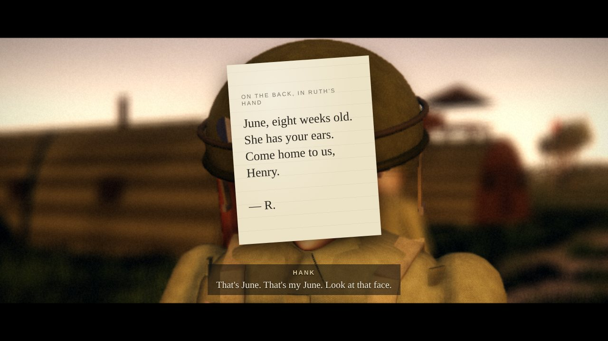
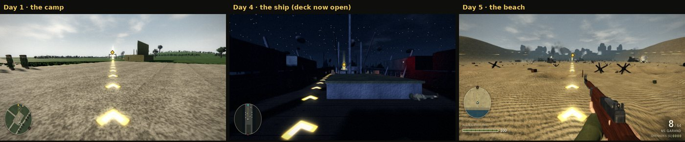

# Beach Rush

A five-day World War II story game that runs in your browser. It's one HTML file with nothing to install, and it works offline.

### ▶ [Play it here](https://blitz-the-dragon.github.io/beach-rush/)

You're Private Cole from Dayton, Ohio, six weeks out of a warehouse job and with nobody waiting at home. In training you meet Pfc. Henry "Hank" Doyle of Altoona, Pennsylvania. He talks about his wife Ruth and his baby daughter June every day, and he whistles a song he made up for her.

| Day | Where |
|---|---|
| 1 | Training camp in Devon, England: the obstacle course, the rifle range, eating alone |
| 2 | Rain. Somebody new sits down next to you |
| 3 | The jeep, mail call and a photograph |
| 4 | The Channel crossing at night, with no lights |
| 5 | H-Hour, Omaha Beach, Normandy |

## Controls

| Key | Action |
|---|---|
| W A S D | move |
| Shift | sprint |
| Mouse | look and aim |
| Left click | fire |
| E | talk, act, continue |
| 1 2 | choose what to say |
| C | crouch |
| G | throw grenade |
| R | reload |
| Enter | skip a line / yell CHARGE |
| V | third-person camera |
| H | jeep horn |
| N | guide arrows on / off |

Glowing arrows on the ground lead you to each objective:

The title screen has quality presets (Low to Ultra). If the frame rate drops, pick a lower one.

## Sound and music

- **Music:** original pieces written for this game (June's Song and its variations), played live by synthesizers in your browser. There are no recordings.
- **Sound effects:** CC0 recordings from Freesound, taken from public repositories that record each file's Freesound origin and CC0 licence:
  - Deases/GunLib
  - MT-CTF/capturetheflag
  - Fris0uman/CDDA-Soundpacks
  - space-wizards/space-station-14
  - rafaelmardojai/blanket
  - karolpiczak/ESC-50 (only clips marked CC0)
- **3D engine:** [three.js](https://threejs.org) r128 (MIT licence), built into the file.
